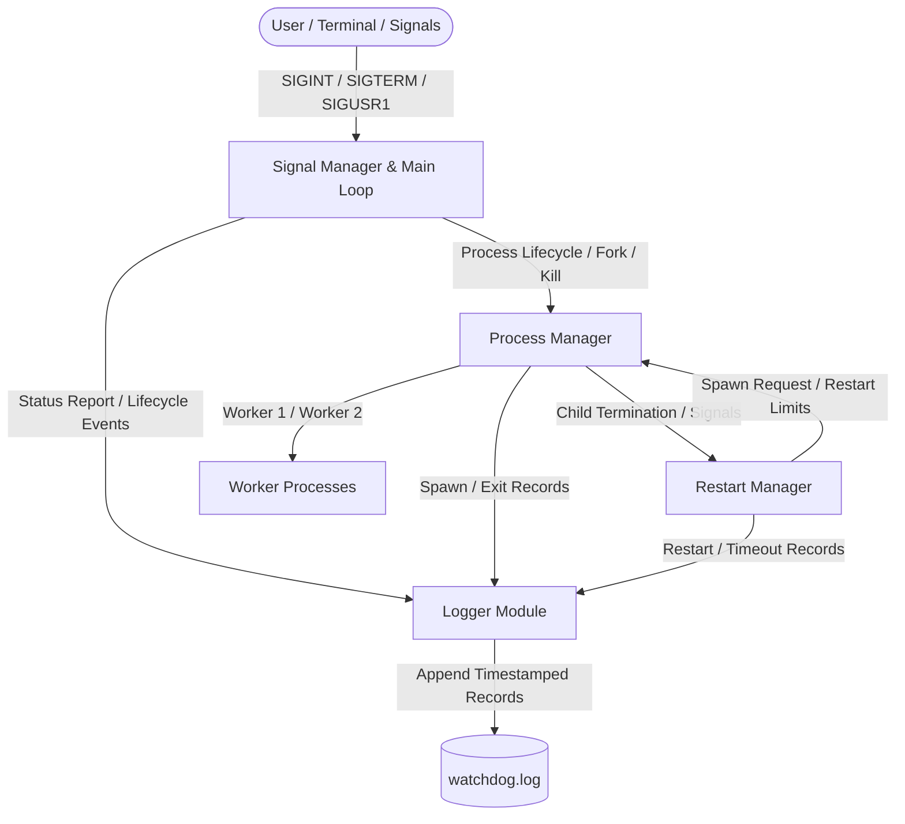

# SAKARYA UNIVERSITY - FACULTY OF COMPUTER AND INFORMATION SCIENCES
## DEPARTMENT OF SOFTWARE ENGINEERING
### SWE301 - System Programming Course | 2026-2027 Fall Semester
### Term Project 1: POSIX Signal-Based Process Monitoring and Management System (Watchdog)

---

## 1. Project Architecture and System Design

This project implements a supervisor program (referred to as the **watchdog**) that creates, monitors, and manages child processes using standard POSIX system calls. The system tracks the lifecycle of child processes, detects crashes, automatically restarts failed processes up to a defined threshold (at most 3 times), responds safely to asynchronous POSIX signals (`SIGINT`, `SIGTERM`, `SIGCHLD`, `SIGUSR1`, `SIGALRM`), and logs all lifecycle events with precise timestamps.

### 1.1. Modular Architecture Overview
The application is structured into four distinct, loosely coupled modules:



### 1.2. POSIX System Calls and Implementation Details
- **`sigaction()` & Async-Signal Safety:** All signal handlers are strictly async-signal-safe. Complex operations, I/O calls, or memory allocations are forbidden inside signal handlers. Handlers only set `volatile sig_atomic_t` flags (`g_shutdown_requested`, `g_sigusr1_received`, `g_sigchld_received`, `g_sigalrm_received`), delegating actual execution to the main control loop.
- **Process Creation & Replacement (`fork`, `execv`, `_exit`):** Child processes are created using `fork()` and execute the worker binary via `execv()`. In case `execv()` fails, `_exit(EXIT_FAILURE)` is invoked instead of `exit()` to prevent double-flushing shared standard I/O buffers.
- **Process Reaping & Exit Status Evaluation (`waitpid`):** `SIGCHLD` events trigger non-blocking reaping using `waitpid(-1, &status, WNOHANG)`. The loop handles `EINTR` interrupts and inspects exit causes:
  - `WIFEXITED(status)`: Differentiates clean normal termination (exit code 0) from unexpected errors (exit code != 0).
  - `WIFSIGNALED(status)`: Identifies termination due to uncaught signals (e.g., `SIGKILL`).
- **Periodic Timer (`setitimer`, `SIGALRM`):** Configures an interval timer (`ITIMER_REAL`) to periodically check child process health and enforce the 5-second shutdown timeout.
- **Controlled Signal Dispatch (`kill`):** Signals are sent to children with return value checking to ensure error handling compliance.

---

## 2. Task Allocation Table

The project was carried out as a 4-person collaborative project with balanced responsibilities:

| Group Member | Responsibilities | Developed Files | Contribution |
| :--- | :--- | :--- | :---: |
| **Elif Gül Arslan** | **Signal Management and Main Control:** Implemented async-signal-safe handlers with `sigaction()`, handled `SIGINT`, `SIGTERM`, `SIGUSR1`, designed the main event loop and graceful shutdown coordination. | `src/main.c`<br>`src/signal_manager.c`<br>`include/signal_manager.h` | **25%** |
| **Ayşenur Yılmaz** | **Child Process Management & Worker:** Implemented `fork()`, `execv()`, `_exit()`, `waitpid()` reaping, exit status evaluation, process table tracking, periodic timer setup, and `workers/worker.c`. | `src/process_manager.c`<br>`include/process_manager.h`<br>`workers/worker.c` | **25%** |
| **Rana İrem Özen** | **Automatic Restart & Shutdown Timeout:** Handled unexpected exit detection, enforced the maximum 3 restart limit, managed the 5-second graceful shutdown timeout, and implemented `SIGKILL` fallback. | `src/restart_manager.c`<br>`include/restart_manager.h` | **25%** |
| **Vildan Karaca** | **Logging, Build System, & Verification:** Developed timestamped event logging, `SIGUSR1` status report generator, test automation suite (`test_scenarios.sh`), `Makefile`, and user documentation. | `src/logger.c`<br>`include/logger.h`<br>`Makefile`<br>`tests/test_scenarios.sh`<br>`README.md` | **25%** |

---

## 3. Test Scenarios and Verification Results (9/9 PASS)

The test suite (`tests/test_scenarios.sh`) was executed on Linux and validated all required specifications:

| No | Scenario | Expected Behavior | Observed Result | Status |
| :---: | :--- | :--- | :--- | :---: |
| **1** | **Build Verification** | Project compiles cleanly with `make` without warnings or errors | `watchdog` and `workers/worker` binaries generated | **PASS** |
| **2** | **Process Creation** | Watchdog starts at least two worker processes and tracks their PIDs | Worker_1 and Worker_2 spawned and tracked | **PASS** |
| **3** | **SIGUSR1 Status Report** | `kill -SIGUSR1` writes active process states to log file | Full status report logged with PID and state | **PASS** |
| **4** | **1st Restart Attempt** | Worker terminated via `SIGKILL` is detected and restarted | Termination logged, new worker spawned (1/3) | **PASS** |
| **5** | **2nd Restart Attempt** | Second unexpected termination triggers automatic restart | New worker spawned with updated PID (2/3) | **PASS** |
| **6** | **3rd Restart Attempt** | Third unexpected termination triggers automatic restart | New worker spawned with updated PID (3/3) | **PASS** |
| **7** | **Restart Limit Enforcement**| 4th termination terminates without further restarts | Limit reached, restart loop avoided | **PASS** |
| **8** | **Graceful Shutdown (SIGTERM)**| `SIGTERM` initiates orderly termination of all child processes | `SIGTERM` dispatched, processes reaped | **PASS** |
| **9** | **Orphan Process Check** | No surviving or orphaned worker processes remain after shutdown | All tracked worker PIDs verified terminated | **PASS** |

### Additional Manual Verifications:
- **Normal Termination Scenario:** A worker process configured with a finite lifespan completed its task and exited normally with `exit(0)`. The watchdog correctly identified normal termination and refrained from restarting it.
- **Ctrl+C (SIGINT) Scenario:** Pressing `Ctrl+C` in the terminal triggered `SIGINT`, initiating the graceful shutdown sequence and cleanly reaping all processes without zombie leakage.

---

## 4. Sample Log Output (`watchdog.log`)

```text
[2026-11-27 12:00:01] Watchdog starting. PID: 3120
[2026-11-27 12:00:01] Surec baslatildi: Worker_1 (PID: 3121)
[2026-11-27 12:00:01] Surec baslatildi: Worker_2 (PID: 3122)
[2026-11-27 12:00:01] Periyodik kontrol zamanlayicisi (1 sn) baslatildi
[2026-11-27 12:00:05] === STATUS REPORT (SIGUSR1) ===
[2026-11-27 12:00:05] Process[0] | Name: Worker_1 | PID: 3121 | State: RUNNING | Restarts: 0
[2026-11-27 12:00:05] Process[1] | Name: Worker_2 | PID: 3122 | State: RUNNING | Restarts: 0
[2026-11-27 12:00:05] === END OF STATUS REPORT ===
[2026-11-27 12:00:10] Worker_1 (PID: 3121) sinyal ile kapandi. Sinyal: 9
[2026-11-27 12:00:10] Unexpected termination: Worker_1, signal: 9.
[2026-11-27 12:00:10] Restart attempt: Worker_1 (1/3).
[2026-11-27 12:00:10] Surec baslatildi: Worker_1 (PID: 3130)
[2026-11-27 12:00:10] Process restarted: Worker_1, PID: 3130, restarts: 1.
[2026-11-27 12:00:20] Graceful shutdown started.
[2026-11-27 12:00:20] Worker_1 (PID: 3130) surecine 15 sinyali gonderiliyor
[2026-11-27 12:00:20] Worker_2 (PID: 3122) surecine 15 sinyali gonderiliyor
[2026-11-27 12:00:21] Worker_1 (PID: 3130) normal kapandi. Cikis kodu: 0
[2026-11-27 12:00:21] Worker_2 (PID: 3122) normal kapandi. Cikis kodu: 0
[2026-11-27 12:00:21] All child processes terminated.
[2026-11-27 12:00:21] Watchdog stopped.
```

---

## 5. Public GitHub Repository and Commit History

- **Public Repository Link:** [https://github.com/elifgularslan/watchdog-project](https://github.com/elifgularslan/watchdog-project)

### Full `git log` Output (Individual Contribution Evidence):
```text
29dcf49 Vildan Karaca 2026-11-27 Merge pull request #4 from elifgularslan/feature/restart-manager
46c7a49 Vildan Karaca 2026-11-27 Merge pull request #3 from elifgularslan/feature/logger
1d6980f Ayşenur Yılmaz 2026-11-26 fix(process-manager): improve error handling, exit logging, and use _exit
11d8ae7 Ayşenur Yılmaz 2026-11-24 feat(process-manager): route internal logs to logger module
2832d53 Rana İrem Özen 2026-11-22 feat: enforce graceful shutdown timeout with SIGKILL fallback
709d38a Rana İrem Özen 2026-11-22 feat: retry pending restarts during periodic checks
38914b6 Rana İrem Özen 2026-11-22 feat: implement bounded restart handling for unexpected exits
4869e5e vildankaraca   2026-11-22 fix(test): verify worker PIDs before signaling and enforce max 3 restart limit check
79184ed vildankaraca   2026-11-22 docs: add README with build, usage, and signal testing instructions
c70e0e9 vildankaraca   2026-11-22 test: add automated test scenarios script for watchdog
571d7d6 vildankaraca   2026-11-22 build: add Makefile to compile watchdog modules and worker
b8b99f4 vildankaraca   2026-11-22 feat: implement timestamped event logging and SIGUSR1 status reporting
a5808b3 Elif Gül Arslan 2026-11-21 Merge pull request #2 from elifgularslan/feature/signal-manager
041cf99 Elif Arslan     2026-11-21 Implement main control loop and graceful shutdown
4a24718 Elif Arslan     2026-11-21 Add SIGALRM handling for periodic process monitoring
4422e39 Elif Arslan     2026-11-21 Implement async-signal-safe signal handlers using sigaction
7873222 Ayşenur Yılmaz 2026-11-21 docs: add clear and informative comments for process management logic
46af154 Ayşenur Yılmaz 2026-11-21 refactor: simplify code comments and remove redundant annotations
b66f731 Ayşenur Yılmaz 2026-11-21 refactor(comments): clean up code comments and remove person-specific annotations
fedaf77 Ayşenur Yılmaz 2026-11-21 Merge branch 'feature/process-manager'
23ef403 Ayşenur Yılmaz 2026-11-21 feat(process-manager): implement periodic check mechanism using setitimer and SIGALRM
a9af129 Ayşenur Yılmaz 2026-11-21 Merge pull request #1 from elifgularslan/feature/process-manager
f760057 Ayşenur Yılmaz 2026-11-21 feat(process-manager): implement child process creation, tracking, and worker process
5291969 Elif Gül Arslan 2026-11-20 Initial commit
```
